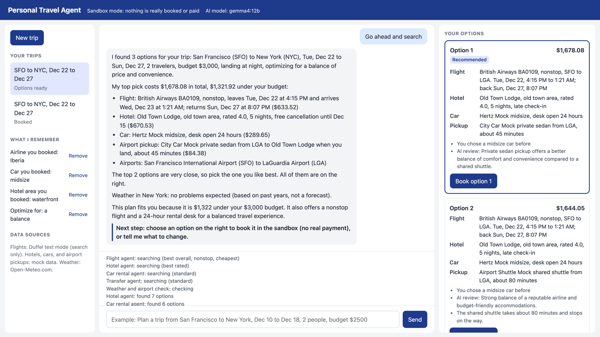
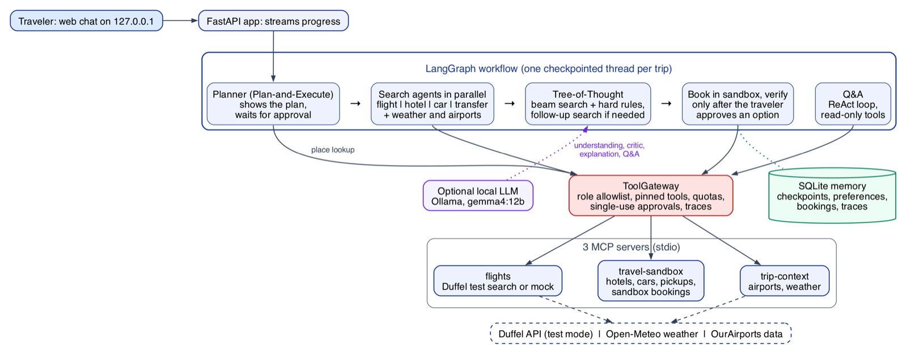

# Personal Travel Planning Agent

My capstone project for the Agentic AI program. You describe a trip in a chat, and the agent plans a flight, a hotel, a rental car, and a ride from the airport. It shows its plan before searching and books nothing until you pick an option. Bookings happen in a sandbox, so nothing is really booked or paid.



## The problem

A trip is four bookings that have to fit together. A cheap flight that lands at 1:21 AM only works if the hotel allows late check-in and the rental desk is still open. People usually check this by hand, and a fully autonomous agent could make up options or spend money without asking. This agent plans from real search results and asks before it acts.

## How it works

1. You describe the trip. If something is missing, it asks.
2. It shows its plan and waits for you to say "go ahead".
3. Four agents search at the same time: flights, hotels, rental cars, and airport pickups.
4. Tree-of-Thought beam search builds complete trips one step at a time, drops anything that breaks a rule (budget, dates, landing time, check-in hours, rental desk hours), and keeps the best 3 at each step.
5. If the trips are over budget or land late, it searches again with only the agents that can fix it.
6. You pick an option. It's booked in the sandbox and checked against what you approved.

## Run it

You need Python 3.11 or newer and [uv](https://docs.astral.sh/uv/getting-started/installation/).

```bash
uv sync --locked
uv run --locked travel-agent    # then open http://127.0.0.1:8000
```

Try `Plan a trip from San Jose to New York on Mar 12 for 5 nights, 2 people, budget $2500, balanced`, then `go ahead`. After that you can say things like `cheaper`, `land at night`, `a different hotel`, `more options`, `what's the weather like?`, or `cancel my car`.

By default, flights, hotels, cars, and pickups are mock data. To see a specific case, start the app with a scenario, like `TRAVEL_AGENT_SCENARIO=over_budget uv run --locked travel-agent`. Others include `late_arrival`, `price_change`, and `sold_out`, and `.env.example` lists them all.

### Optional extras

Both are set in a `.env` file (copy `.env.example`).

- Real flight search: create a test token with read-write access in the [Duffel dashboard](https://dashboard.duffel.com) (More > Developers > Access tokens) and set `DUFFEL_ACCESS_TOKEN=duffel_test_...`. Duffel is only used to search and recheck prices, and bookings stay in the sandbox. Check it with `uv run python scripts/check_duffel.py`.
- A local language model: install and start [Ollama](https://ollama.com), run `ollama pull gemma4:12b`, and set `TRAVEL_AGENT_LLM_ENABLED=true` and `TRAVEL_AGENT_LLM_MODEL=gemma4:12b`. It handles messages the keyword rules miss, comments on the options, and answers questions. Check it with `uv run python scripts/check_llm.py`. I've only tested `gemma4:12b`.

## Architecture



A FastAPI web chat runs a LangGraph workflow, with one saved thread per trip in SQLite. LangGraph runs the search agents in parallel and pauses for your three approvals: the plan, the option, and any cancellation. Every tool call goes through one gateway, which checks permissions, pinned tool definitions, call limits, and approvals before calling one of three local MCP servers: flights, the travel sandbox, and trip context (weather and airports).

The main code is in `src/travel_agent/`: `graph/` (the workflow), `agents/` (the Planner and search agents), `engine/` (Tree-of-Thought), `mcp_servers/`, and `tool_gateway.py`.

## Safety

- It searches only after you approve the plan and books only the option you pick. Typing "yes" never books or cancels.
- Each booking needs a one-time approval for the exact item, price, and dates.
- Search agents can only use read-only tools, and every option comes from a tool result.
- It doesn't collect names or payment details, and the app only listens on 127.0.0.1.

## Evaluation

`uv run python -m travel_agent.eval` runs five scenarios through the real workflow with mock data. All 5 pass: every proposed item came from a tool result, every date matched the trip, and nothing was booked without approval. The results are in [docs/evaluation-report.md](docs/evaluation-report.md), what I checked by hand is in [docs/status.md](docs/status.md), and [docs/sample-conversation.md](docs/sample-conversation.md) is a full chat.

## Limitations

- Hotels, cars, and pickups are mock data, and Duffel's test fares aren't real.
- Without the model, only set phrases are understood.
- Flights have to land by 5 AM the day after they leave, which rules out many overnight flights.
- The first options often share the same hotel.

## Data

Airports from [OurAirports](https://ourairports.com/data/) (public domain). Weather from [Open-Meteo](https://open-meteo.com/) (CC BY 4.0).
